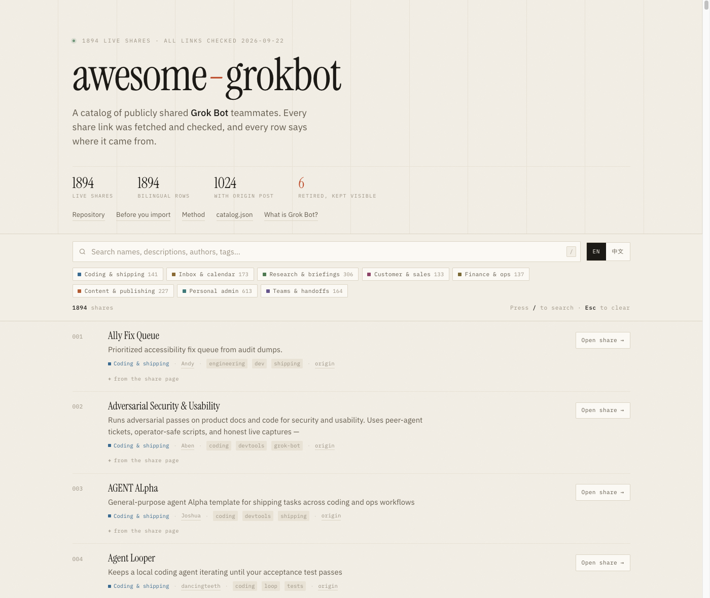

<h1 align="center">awesome-grokbot</h1>

<h3 align="center">5010 live <code>x.ai/bot</code> shares for Grok Bot. Every link status-checked. Every row attributed to where it came from.</h3>

  
  
  
  
  
  
  

  <strong>English</strong> | <a href="./README.zh-CN.md">简体中文</a>

> [Grok Bot](https://docs.x.ai/grok-bot/overview) gives named AI teammates their own always-on cloud computer. This repo is not Grok Bot, not an installer, and not source code — it is the index of public bot configurations you can preview on `x.ai` and add to your own account in one click.

## ⚡️ What's different

<table>
  <tr><td align="right"><b>5010</b></td><td>live shares, every link fetched on 2026-11-16 — not copied from another list</td></tr>
  <tr><td align="right"><b>daily</b></td><td>re-checked and synced against four upstream catalogs by <a href=".github/workflows/daily-update.yml">a scheduled job</a>, not a one-off scrape</td></tr>
  <tr><td align="right"><b>93</b></td><td>dead links quarantined in <a href="retired.json"><code>retired.json</code></a>, not left rotting in place</td></tr>
  <tr><td align="right"><b>5010</b></td><td>rows with a hand-written Chinese summary</td></tr>
  <tr><td align="right"><b>5010</b></td><td>rows naming the catalog they came from — 2136 also link the original post</td></tr>
  <tr><td align="right"><b>217</b></td><td>rows whose name had drifted from the live page, kept searchable as <code>aka</code></td></tr>
  <tr><td align="right"><b><a href="https://kydlikebtc.github.io/awesome-grokbot/#official=1">56</a></b></td><td>published by an organisation itself rather than an individual — SpaceX, marked official in the lists</td></tr>
</table>

Names and blurbs are read from the live share page, not from another catalog. How the catalog was built, and what it does **not** verify: [docs/method.md](docs/method.md).

## 🌐 Browse it as a site

  

  <a href="https://kydlikebtc.github.io/awesome-grokbot/"><strong>kydlikebtc.github.io/awesome-grokbot</strong></a> 
  Instant search over all 5010 rows · eight category filters · EN/中文 · shareable filtered URLs · no build step, no tracking, no cookies

**Every filter lives in the URL.** These links open a pre-filtered view — and stay shareable:

  <a href="https://kydlikebtc.github.io/awesome-grokbot/#cat=coding-shipping">🛠️ Coding&nbsp;&amp;&nbsp;shipping <b>316</b></a> · <a href="https://kydlikebtc.github.io/awesome-grokbot/#cat=inbox-calendar">📥 Inbox&nbsp;&amp;&nbsp;calendar <b>485</b></a> · <a href="https://kydlikebtc.github.io/awesome-grokbot/#cat=research-briefings">🔍 Research&nbsp;&amp;&nbsp;briefings <b>784</b></a> · <a href="https://kydlikebtc.github.io/awesome-grokbot/#cat=customer-sales">🤝 Customer&nbsp;&amp;&nbsp;sales <b>290</b></a> 
  <a href="https://kydlikebtc.github.io/awesome-grokbot/#cat=finance-ops">💰 Finance&nbsp;&amp;&nbsp;ops <b>305</b></a> · <a href="https://kydlikebtc.github.io/awesome-grokbot/#cat=content-publishing">✍️ Content&nbsp;&amp;&nbsp;publishing <b>533</b></a> · <a href="https://kydlikebtc.github.io/awesome-grokbot/#cat=personal-admin">🏠 Personal&nbsp;admin <b>2073</b></a> · <a href="https://kydlikebtc.github.io/awesome-grokbot/#cat=teams-handoffs">🧭 Teams&nbsp;&amp;&nbsp;handoffs <b>224</b></a>

## 📖 Quick links

| Go to | For |
| --- | --- |
| 🌐 [**Browse as a site**](https://kydlikebtc.github.io/awesome-grokbot/) | Search and filter all 5010 rows in the browser |
| 📦 [`catalog.json`](catalog.json) | All 5010 live entries, schema-validated |
| 🪦 [`retired.json`](retired.json) | 93 shares that stopped resolving |
| 🔐 [Before you import](docs/vetting.md) | Safety checklist. Read this before adding anything |
| 🧪 [Data & method](docs/method.md) | How the catalog was built and how to reproduce it |
| 🤖 [Scout routine](docs/routine.md) | A Grok Bot routine that finds new shares on X, first-hand |
| 🙏 [Sources & credits](docs/sources.md) | Upstream catalogs this merges, with licences |
| 🤝 [Contributing](CONTRIBUTING.md) | Add a bot in one JSON object |

## 🚀 How to use

1. [Install Grok Bot](https://docs.x.ai/grok-bot/get-started) on Mac, Windows or iPhone. There is no official Linux desktop build — the bot's own computer is already Linux, in the cloud.
2. Open any share link below and read the public preview **before** you add it.
3. Press **Add to Grok Bot**. That copies the name, instructions, skills, routines and first-party plugin ids.
4. It does **not** copy the author's computer, files, logins or API keys. Reconnect connectors yourself, one at a time.
5. Run one read-only task first. Only then enable routines or anything that writes.

> [!WARNING]
> A community share is untrusted third-party software. All bots on one account **share a single computer** — a second bot is not a security boundary. Full checklist: [docs/vetting.md](docs/vetting.md).

## 🗂️ Categories

<table>
  <tr>
    <td width="25%" valign="top">
<strong><a href="docs/category/coding-shipping.md">🛠️ Coding &amp; shipping</a></strong> 316 bots
Write code, review PRs, babysit coding agents, keep the box healthy.  <a href="https://kydlikebtc.github.io/awesome-grokbot/#cat=coding-shipping">filter on the site ↗</a></td>
    <td width="25%" valign="top">
<strong><a href="docs/category/inbox-calendar.md">📥 Inbox &amp; calendar</a></strong> 485 bots
Triage mail, draft replies, defend the calendar, run the weekday rhythm.  <a href="https://kydlikebtc.github.io/awesome-grokbot/#cat=inbox-calendar">filter on the site ↗</a></td>
    <td width="25%" valign="top">
<strong><a href="docs/category/research-briefings.md">🔍 Research &amp; briefings</a></strong> 784 bots
Watch a beat, verify claims, and hand back one short brief.  <a href="https://kydlikebtc.github.io/awesome-grokbot/#cat=research-briefings">filter on the site ↗</a></td>
    <td width="25%" valign="top">
<strong><a href="docs/category/customer-sales.md">🤝 Customer &amp; sales</a></strong> 290 bots
Prospecting, outbound drafts, call support, and account follow-through.  <a href="https://kydlikebtc.github.io/awesome-grokbot/#cat=customer-sales">filter on the site ↗</a></td>
  </tr>
  <tr>
    <td width="25%" valign="top">
<strong><a href="docs/category/finance-ops.md">💰 Finance &amp; ops</a></strong> 305 bots
Receipts, subscriptions, invoices, spend audits, and back-office chores.  <a href="https://kydlikebtc.github.io/awesome-grokbot/#cat=finance-ops">filter on the site ↗</a></td>
    <td width="25%" valign="top">
<strong><a href="docs/category/content-publishing.md">✍️ Content &amp; publishing</a></strong> 533 bots
Drafting, editing, design, video, and the queue that ships it.  <a href="https://kydlikebtc.github.io/awesome-grokbot/#cat=content-publishing">filter on the site ↗</a></td>
    <td width="25%" valign="top">
<strong><a href="docs/category/personal-admin.md">🏠 Personal admin</a></strong> 2073 bots
Groceries, household logistics, family schedules, health, and shopping.  <a href="https://kydlikebtc.github.io/awesome-grokbot/#cat=personal-admin">filter on the site ↗</a></td>
    <td width="25%" valign="top">
<strong><a href="docs/category/teams-handoffs.md">🧭 Teams &amp; handoffs</a></strong> 224 bots
Bots that run other bots: rosters, delegation, budgets, and handoffs.  <a href="https://kydlikebtc.github.io/awesome-grokbot/#cat=teams-handoffs">filter on the site ↗</a></td>
  </tr>
</table>

| Category | Bots |
| --- | ---: |
| [🛠️ Coding & shipping](docs/category/coding-shipping.md) | 316 |
| [📥 Inbox & calendar](docs/category/inbox-calendar.md) | 485 |
| [🔍 Research & briefings](docs/category/research-briefings.md) | 784 |
| [🤝 Customer & sales](docs/category/customer-sales.md) | 290 |
| [💰 Finance & ops](docs/category/finance-ops.md) | 305 |
| [✍️ Content & publishing](docs/category/content-publishing.md) | 533 |
| [🏠 Personal admin](docs/category/personal-admin.md) | 2073 |
| [🧭 Teams & handoffs](docs/category/teams-handoffs.md) | 224 |
| **Total** | **5010** |

## 🪦 Retired shares

These 93 shares appear in upstream catalogs but no longer resolve as of 2026-11-16. They are listed so you can recognise a stale link elsewhere, not so you can import them.

| Bot | Status | Last seen in |
| --- | :---: | --- |
| `Bot Creator` | `HTTP 404` | cs68614-hash |
| `Freelance Prospector` | `HTTP 404` | ZeroPointRepo, cs68614-hash, elie222 |
| `OpenZoo.fun Grok Bot Demo` | `HTTP 404` | cs68614-hash |
| `Randal` | `HTTP 404` | cs68614-hash |
| `Steve J` | `HTTP 404` | ZeroPointRepo, cs68614-hash |
| `AISØN Vice Captain` | `HTTP 404` | majiayu000, cs68614-hash |
| `Coach Tony` | `HTTP 404` | majiayu000, cs68614-hash |
| `Marcus Aurelius` | `HTTP 404` | majiayu000, cs68614-hash, ZeroPointRepo |
| `Beowulf` | `HTTP 404` | majiayu000, ZeroPointRepo |
| `gb-live` | `HTTP 404` | majiayu000, cs68614-hash, ZeroPointRepo |
| `Sunlight` | `HTTP 404` | majiayu000, cs68614-hash, ZeroPointRepo |
| `RIZALBOT` | `HTTP 404` | majiayu000 |
| `Little x` | `HTTP 404` | majiayu000, cs68614-hash, ZeroPointRepo |
| `Porter` | `HTTP 404` | majiayu000, cs68614-hash, ZeroPointRepo |
| `SniffBot` | `HTTP 404` | majiayu000, cs68614-hash, ZeroPointRepo |
| `Fab Four` | `HTTP 404` | majiayu000, cs68614-hash |
| `Sanity` | `HTTP 404` | majiayu000, ZeroPointRepo, elie222 |
| `City Council Notes` | `HTTP 404` | majiayu000, cs68614-hash |
| `Finance Fish` | `HTTP 404` | majiayu000, cs68614-hash |
| `Research Lead` | `HTTP 404` | majiayu000, cs68614-hash |
| `ShopFloor Chief` | `HTTP 404` | majiayu000, cs68614-hash |
| `Polymarket Scans` | `HTTP 404` | majiayu000, cs68614-hash |
| `AI Context & Skills Hub` | `HTTP 404` | majiayu000 |
| `coffee companion` | `HTTP 404` | majiayu000, cs68614-hash, ZeroPointRepo |
| `Dinner Plan` | `HTTP 404` | majiayu000, cs68614-hash |
| `What Would Jesus Do?` | `HTTP 404` | majiayu000, cs68614-hash |
| `Change Check` | `HTTP 404` | majiayu000, cs68614-hash |
| `Confidence Gate Code Reviewer` | `HTTP 404` | majiayu000 |
| `Grok Build` | `HTTP 404` | majiayu000, cs68614-hash |
| `Daily Writing Buddy` | `HTTP 404` | majiayu000, cs68614-hash, ZeroPointRepo |
| `Spruce` | `HTTP 404` | majiayu000 |
| `Tech Team Draft` | `HTTP 404` | majiayu000, cs68614-hash |
| `$0 Launch Team` | `HTTP 404` | majiayu000, cs68614-hash |
| `Call Desk` | `HTTP 404` | ZeroPointRepo |
| `Lobster Agents` | `HTTP 404` | majiayu000, cs68614-hash |
| `XChat 고객센터 봇` | `HTTP 404` | majiayu000, ZeroPointRepo |
| `FUTU 브로커 주식 거래 봇` | `HTTP 404` | majiayu000 |
| `Lease Finder` | `HTTP 404` | majiayu000, ZeroPointRepo, elie222 |
| `Local Events Scout` | `HTTP 404` | majiayu000, cs68614-hash |
| `Trading` | `HTTP 404` | elie222 |
| `Gemini 4 死了没` | `HTTP 404` | majiayu000, cs68614-hash |
| `Inbox Zero Chief of Staff` | `HTTP 404` | majiayu000, cs68614-hash |
| `Life Admin` | `HTTP 404` | majiayu000, cs68614-hash |
| `Mail Junkie` | `HTTP 404` | majiayu000, cs68614-hash |
| `My Morning View` | `HTTP 404` | majiayu000, cs68614-hash |
| `X Bookmarks Digest` | `HTTP 404` | majiayu000, cs68614-hash |
| `행사 참석 확인 폼 메이커` | `HTTP 404` | majiayu000 |
| `Alibaba Buyer Ops` | `HTTP 404` | majiayu000, cs68614-hash, ZeroPointRepo |
| `App Security Tester` | `HTTP 404` | majiayu000, cs68614-hash |
| `Auguste, Head Chef` | `HTTP 404` | majiayu000, cs68614-hash |
| `Bot Ops Monitor` | `HTTP 404` | majiayu000, cs68614-hash |
| `Bottleneck Killer` | `HTTP 404` | majiayu000, cs68614-hash |
| `Brand Community Manager` | `HTTP 404` | majiayu000, cs68614-hash |
| `CleanText` | `HTTP 404` | majiayu000 |
| `Comprador` | `HTTP 404` | majiayu000, ZeroPointRepo |
| `Crux` | `HTTP 404` | majiayu000, cs68614-hash |
| `Daily Signpost` | `HTTP 404` | majiayu000 |
| `Disney Ride Strategist` | `HTTP 404` | majiayu000, ZeroPointRepo, elie222 |
| `Fitness Bot` | `HTTP 404` | majiayu000, ZeroPointRepo |
| `Fleet Doctor` | `HTTP 404` | majiayu000, cs68614-hash |
| `Food Run` | `HTTP 404` | majiayu000, cs68614-hash |
| `Grokmas Elf` | `HTTP 404` | majiayu000, cs68614-hash |
| `Home Robot` | `HTTP 404` | majiayu000, cs68614-hash |
| `Hypr Logo Cursor` | `HTTP 404` | majiayu000 |
| `ImmigrationGuide` | `HTTP 404` | majiayu000, cs68614-hash |
| `Launch Watcher` | `HTTP 404` | majiayu000, cs68614-hash |
| `Menago` | `HTTP 404` | majiayu000, cs68614-hash |
| `New Home Buddy` | `HTTP 404` | majiayu000, cs68614-hash |
| `PC Helper` | `HTTP 404` | majiayu000, cs68614-hash, ZeroPointRepo |
| `Personal Shopper` | `HTTP 404` | majiayu000, cs68614-hash |
| `PizzaPLUG` | `HTTP 404` | majiayu000, cs68614-hash |
| `Ship Check` | `HTTP 404` | majiayu000, cs68614-hash |
| `SpanishReviewer` | `HTTP 404` | majiayu000 |
| `Stock Lilo Strategy` | `HTTP 404` | majiayu000, cs68614-hash |
| `Stow` | `HTTP 404` | majiayu000, cs68614-hash |
| `Sui Generis` | `HTTP 404` | majiayu000, cs68614-hash, ZeroPointRepo |
| `The Bouncer` | `HTTP 404` | majiayu000, cs68614-hash, ZeroPointRepo |
| `YouTube Strategist` | `HTTP 404` | majiayu000 |
| `장보기` | `HTTP 404` | majiayu000, cs68614-hash, ZeroPointRepo |
| `토스 증권 주식 투자봇` | `HTTP 404` | majiayu000, cs68614-hash |
| `Chief of Staff` | `HTTP 404` | majiayu000, cs68614-hash |
| `Deep Researcher` | `HTTP 404` | majiayu000, cs68614-hash |
| `Investor Pipeline Builder` | `HTTP 404` | majiayu000, cs68614-hash |
| `MDH Hill Charts` | `HTTP 404` | majiayu000, cs68614-hash |
| `Newsroom to Teleprompter` | `HTTP 404` | majiayu000, cs68614-hash, ZeroPointRepo |
| `Stonkie` | `HTTP 404` | majiayu000, cs68614-hash |
| `Topic Radar` | `HTTP 404` | majiayu000, cs68614-hash |
| `TripConcierge` | `HTTP 404` | majiayu000 |
| `X Researcher` | `HTTP 404` | majiayu000 |
| `XChat 사례 큐레이터 봇` | `HTTP 404` | majiayu000 |
| `藍苺守 織` | `HTTP 404` | majiayu000, cs68614-hash, ZeroPointRepo |
| `firstlight` | `HTTP 404` | majiayu000, cs68614-hash, ZeroPointRepo |
| `Fleet Review Desk` | `HTTP 404` | majiayu000 |

## 📊 Data & method

The catalog is a merge of four community sources plus a first-party verification pass. Merge key is the id inside `https://x.ai/bot/<id>`, so duplicate rows across catalogs collapse into one.

| Step | Result |
| --- | --- |
| Unique share ids found across 4 catalogs | 365 |
| Answered under 400 on 2026-11-16 | **5010** |
| Answered 404 across two sweeps → `retired.json` | 93 |
| Rows enriched with first-party `og:` metadata | 5010 |
| Rows whose live name differs from the community catalogs | 217 (5 substantive, 27 qualifier-only) |
| Rows attributed to 2+ upstream catalogs | 3977 |
| Rows with a Chinese summary | 5010 / 5010 |

Reproduce it yourself with [`scripts/check_links.py`](scripts/check_links.py) (re-sweeps every share) and [`scripts/lint.py`](scripts/lint.py) (validates against [`schema/entry.schema.json`](schema/entry.schema.json)). Method notes: [docs/method.md](docs/method.md).

## 🙏 Sources & credits

This list stands on work other people did first. Each catalog row names its upstream in `sources[]`; the four merged catalogs are:

| Upstream catalog | What it contributed |
| --- | --- |
| [majiayu000/awesome-grok-bot](https://github.com/majiayu000/awesome-grok-bot) | Live-share catalog with a maintained 8-way taxonomy and Chinese summaries. |
| [ZeroPointRepo/GrokBotDev](https://github.com/ZeroPointRepo/GrokBotDev) | Agent-run directory with the richest per-bot metadata (sharer, origin post, tags). |
| [cs68614-hash/awesome-grokbot-templates](https://github.com/cs68614-hash/awesome-grokbot-templates) | Community-scraped share IDs, several of which appear nowhere else. |
| [elie222/botdirectory.ai](https://github.com/elie222/botdirectory.ai) | Open directory of agent-bot prompts; contributor and origin-post attribution. |

Full attribution and licence notes: [docs/sources.md](docs/sources.md).

## 📄 Disclaimer

- This repo indexes **publicly shared** Grok Bot configurations. It claims no ownership over any bot, prompt or profile listed here.
- Bot names and blurbs are the authors' own, read from the public share page. Chinese summaries are this repo's editorial translations.
- A reachable share page proves the page loads. It does **not** prove the bot is safe, maintained, or does what its description claims. Vet before you import.
- Adding a community share accepts Grok Bot's third-party bot terms. Some listed bots touch money, trading, or outbound messaging — read the profile before connecting anything.
- If you authored a bot listed here and want the row changed or removed, [open an issue](https://github.com/kydlikebtc/awesome-grokbot/issues/new) and it will be handled promptly.

**If this saved you time, a ⭐ helps other people find it.**

## 📈 Star history

<a href="https://www.star-history.com/?repos=kydlikebtc%2Fawesome-grokbot&type=date&legend=top-left">
  <picture>
    <source media="(prefers-color-scheme: dark)" srcset="https://api.star-history.com/chart?repos=kydlikebtc/awesome-grokbot&type=date&theme=dark&legend=top-left&sealed_token=BoG0OxnzM4lq1OKxIgBu2gljBCJ0_qHxRsoMLE0htVH1mUQcNm797BqzWzZ4OkKYaorgvWJ34tbAMpmOzl5uM0ASebVQ-br8QHfKgH_WZsBqzV4WgM5P4Q&v=2026-11-16" />
    <source media="(prefers-color-scheme: light)" srcset="https://api.star-history.com/chart?repos=kydlikebtc/awesome-grokbot&type=date&legend=top-left&sealed_token=BoG0OxnzM4lq1OKxIgBu2gljBCJ0_qHxRsoMLE0htVH1mUQcNm797BqzWzZ4OkKYaorgvWJ34tbAMpmOzl5uM0ASebVQ-br8QHfKgH_WZsBqzV4WgM5P4Q&v=2026-11-16" />
    
  </picture>
</a>

## 📜 Licence

The catalog data (`catalog.json`, `retired.json`) is released under [CC0-1.0](LICENSE-CC0) — take it, fork it, build on it. The scripts are [MIT](LICENSE-MIT). Linked bots and their profiles belong to their authors.

